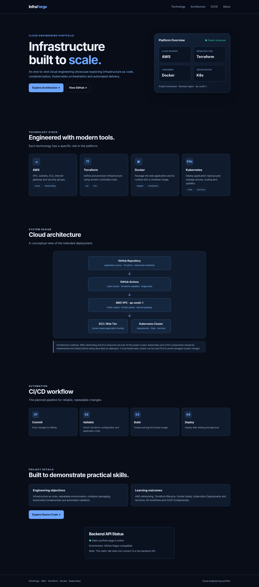
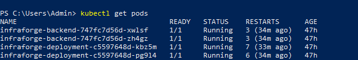
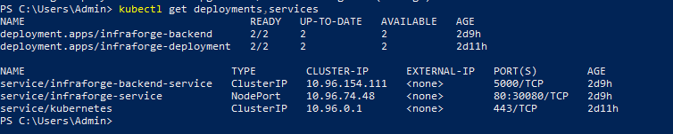
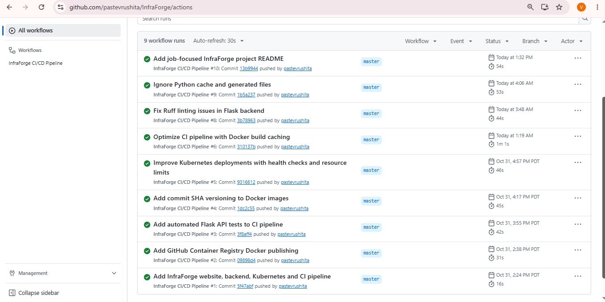

# InfraForge

InfraForge demonstrates practical implementation of cloud infrastructure using AWS and Terraform, application containerization using Docker, local Kubernetes orchestration, and automated testing and image publishing through GitHub Actions.

## Technical Skills Demonstrated

- **AWS:** EC2, VPC, Subnets, Internet Gateway, Security Groups
- **Infrastructure as Code:** Terraform
- **Containerization:** Docker
- **Orchestration:** Kubernetes (Docker Desktop)
- **Programming:** Python, Flask
- **Web Server:** Nginx
- **CI/CD:** GitHub Actions
- **Testing & Code Quality:** Pytest, Ruff
- **Version Control:** Git, GitHub
- **Container Registry:** GitHub Container Registry (GHCR)

## Project Highlights

- Provisioned AWS infrastructure using Terraform.
- Built and containerized a Flask backend and Nginx frontend.
- Configured Kubernetes Deployments, Services, replicas, health probes, and resource limits.
- Automated code quality checks and API testing using GitHub Actions.
- Built and published versioned Docker images to GitHub Container Registry.
- Tested frontend-to-backend communication and application health endpoints.

## Project Screenshots

### InfraForge Website

### Kubernetes Pods

### Kubernetes Deployments and Services

### GitHub Actions CI/CD Pipeline
